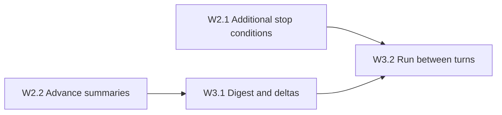

# Detailed fork roadmap

The RimMCP fork is building toward a repeatable colony and campaign workflow. An agent should be able to observe the whole map, get detail where it matters, issue a batch of validated orders, and let the game run until something merits attention. Support for the existing game interface and clear recovery from omitted data are part of that workflow.

[Why this fork](../README.md#why-this-fork) · [High-level roadmap](roadmap.md) · [Survey and verification workflow](survey-workflow.md)

## Progress

Record each package's status, commit and date here. Keep the verification evidence with the implementation or its linked playtest record.

- Implemented November 26 in RimMCP commit `73da9d2`: **W0.1** play metrics, **W0.3** build identity, and **W0.4** the macOS check script.
- Implemented and verified November 26 in `94ac216`: **W0.2** reply budget and proxy ceilings.
- Implemented and verified November 26 in `29bd0f1`: **W1.A** shared selectors, field projections, and batched reads. Baseline commit `68563d6`.
- Implemented and verified November 26 in `bfcf73c`: **W1.B** watcher table. Baseline commit `cf9c07a`.
- Implemented and verified November 26 in `d031382`: **W1.C** layer registry, scale, and counts. Baseline commit `d981111`.
- Implemented and verified November 26 in `c4d74b9`: **W2.4** thin whole-map survey and named tiles.
- Implemented and verified November 26 in `65188cd`: **W2.5** mover groups and **W2.6** notable things and map-wide building reads.
- Implemented November 27 through **W2.13**, including the advance summary and new stops. Verified the adopted research-complete dialog in the running game. [Wave 2 workflow and checks](wave-2-workflow.md)
- **W2.14**, **W2.15**, and **W3.1** landed November 27 in `dbe0621`. They add native Ideology rituals, setup scenario previews, a turn digest, and revisioned survey and list reads. [Wave 2 workflow and checks](wave-2-workflow.md)
- **W3.2–W3.12** landed in `a89f235`. They add watcher-driven time, stock effects capture, construction planning, derived layers, structure templates, a [source cache and RimSage workflow](source-research.md), thing notes, exports, suggested work priorities, and cooler and hunger checks. [Wave 3 workflow](wave-3-workflow.md)
- **Wave 4** landed in `a89f235`. It adds native caravan drafts and packing, food and spoilage estimates, departure and travel stops, and encounter reform. The Nov. 27 disposable round trip reached Swampston and returned to the loaded home map. [Campaign workflow](wave-4-campaign.md)
- **W5.1**, **W5.2**, and the **W5.4** scribe workflow are implemented locally. The Nov. 27 disposable trial exercised role scoping, action attribution, a steward retry, incremental events, a diagnostic read, and a verified save and reload. **W5.3** has client setup and role prompts. The live transport trial used scripted MCP clients, with model-driven coordination still to try. [Wave 5 evidence and reproduction](wave-5-roles.md)

At the November 27 checkpoint, `8b0f71c` includes the source-research guide and Wave 5 plan. The Wave 5 implementation and verification docs are local changes. The tested DLL and proxy ran on RimWorld **1.6.4871 rev597**. The latest recorded suite passed **24 proxy tests** and **97 compatibility checks**, with three expected Unity-native failures under standalone Mono. [Wave 5 verification](wave-5-roles.md#november-27-verification)

## Remaining work

### Close Wave 5

The stdio proxy now advertises an offline [getting-started resource](getting-started.md) and sends concise role-specific startup guidance for main, steward, scribe, and the optional Sentinel, Land advisor, Builder, and Researcher roles. Verify how Codex and Claude Code surface that guidance during the independent role trials.

The light writing trial produced a diary and handoff from scripted live role responses, reusing the main digest and save receipt. [Trial evidence and scope](wave-5-roles.md#light-writing-trial)

1. Run the main, steward, and scribe prompts on one disposable save in Codex, then repeat with Claude Code. Confirm each session has only its assigned RimMCP connection. Have the steward make one approved work change, then hand the receipt to the main agent. The main agent advances and verifies a save. [Client setup](wave-5-roles.md#connect-a-client)
2. Hand the scribe the actual digest, operation receipt, and prior history cursor. Check the written diary and resumable handoff against the observed load, map, tick, game event, diagnostic excerpt, and verified save. Repeat the checkpoint and reload. Verify that an incomplete-history reply produces an explicit coverage note. The scripted run covered a repeated event and load reset. Live history loss remains open. [Scribe inputs and verification](#wave-5--main-agent-and-maintenance-agents)
3. Record the added calls and reply bytes from the scribe's role metrics, including which inputs it reused from the main agent. Record the client and the fixture in the trial handoff. [Role metrics](wave-5-roles.md#verify-a-role)

### Verify existing capabilities in more play conditions

| Area | Evidence so far | Remaining check |
| --- | --- | --- |
| Native raid and movers | Trader grouping and a synthetic hostile group exercised the survey. | Observe a native raid's group and stage changes and compare them with the map and watcher stop. [Survey evidence](survey-workflow.md) |
| Hostile expedition | A friendly round trip completed. A separate controlled encounter verified native arrival, refusal with defenders active, and reform and return after clearance. | Play a complete hostile expedition and verify its actual settlement outcome, surviving roster, cargo, and home recovery. [Campaign evidence](wave-4-campaign.md#recorded-live-verification) |
| Medical and construction | Medical reads and a standing-pawn rescue refusal were exercised. A natural-wall smoothing order was accepted and work began. | Verify a successful rescue and its bed, active blood loss, an infection with rising immunity, and completion of natural-wall smoothing. |
| Runtime compatibility | The recent wave trials used 1.6.4871 rev597. | Run the current mod and proxy on a 1.7 disposable save. Check startup, context, turn digest, a command, caravan flow, and scoped discovery. The three Unity-native checks excluded by the standalone Mono harness need Unity for direct verification. |
| Source provenance | RimSage's rebuilt rev595 index returned plant and caravan methods and shipped Def XML. | Rebuild against rev597 when researching the disposable fixtures. Compare game version and assembly hash, then pair any inference with a live check. [RimSage workflow](source-research.md#use-rimsage-with-rimmcp) |

### Follow-up capabilities from playtests

| Area | Remaining scope |
| --- | --- |
| Campaign and expansion | Native trading and encounter decisions beyond the supported generic dialog path. A compact Anomaly read for discovered monolith state, unlocks, study, and containment. |
| Colony decisions | Food production and harvest attribution alongside the stock movement trend. Validate the need for a native early-harvest order after using exact plant IDs and game-checked designations. Survey group IDs as selectors and proximity-based watches are design ideas to revisit after the native raid trial. |
| Batch reads and templates | Batch `list_gizmos` remains from E6. `get_pawn` and `get_building` already batch by ID, and `set_building_toggles` batches repeated toggles. Extend P4's tested bedroom, freezer and pen set with the original barracks, hospital, and kitchen plans as needed. |
| Reference coverage | `export_reference` provides building data, research prerequisites and facilities, and scenario/storyteller/difficulty data. P2 research unlocks and P3 trait degrees, work types, and xenotypes remain export extensions. Trait validation guidance can use the same catalog. |
| Optional integrations | An in-game Workshop Rimdex lookup bridge. The existing offline Rimdex Reference and versioned RimSage sources cover separate research tasks. |

Choose a follow-up capability after the live trial identifies the decision it would improve. Keep the original package estimates and playtest requests as historical context.

## Critical path

Advance summaries feed the compact turn digest. The digest and additional stop conditions then support a mode that keeps RimWorld running between turns. The selector, watcher, layer and survey foundations already appear in the progress list.



## How to read the grades

**Design complexity** is graded 1 to 5. It measures how much has to be decided and how far a change can affect callers.

| Grade | Meaning | Typical shape |
| --- | --- | --- |
| 1 | Mechanical. The design is fully settled. | One file and a few dozen lines, following an existing pattern |
| 2 | Small, with local decisions | One or two files, a new field or parameter, one new test |
| 3 | A new shared piece, or a refactor that needs a pinning test first | Several files. Other packages build on it, so its interface matters. |
| 4 | Composite: several shared pieces together, or behaviour players notice | Many files, design choices with trade-offs, a live check that matters |
| 5 | Unknown game internals or threading. A spike comes first. | Harmony patches, off-thread work, behaviour that has to be found in decompiled code |

**Risk** is graded separately as low (L), medium (M), or high (H) based on how likely the game is to behave unexpectedly.

## Verification for each package

- Pin existing behavior in a separate test commit before a refactor. Keep the pin unchanged and passing through the implementation commit.
- Run the mod build, proxy tests, and compatibility harness. On macOS, use [`scripts/check-rimcp.sh`](../scripts/check-rimcp.sh). Under Mono, three documented checks need Unity's runtime.
- Verify the normal MCP path on a disposable save. Record the build, save, load ID, tick, and observed result. When changing a read, compare UTF-8 payload sizes under the same conditions. [Verification examples](survey-workflow.md#verify-a-build)
- Tool schemas live in [the shared manifest](../Shared/ToolManifest.cs). Route handlers and compatibility checks live in [the bridge router](../RiMCP/Source/Bridge/BridgeRouter.cs) and [the harness](../tests/CompatibilityRegression/Program.cs).

## Waves

```
Wave 0  measure, cap, tooling                 (small, mostly parallel)
   │
Wave 1  three shared interfaces, in three lanes    (pin first, then refactor)
   │      A selector + fields   B watcher table   C layer registry
   │
Wave 2  expand the shared interfaces (widest parallelism)
   │
Wave 3  composites: digest, live mode, plan evaluator, derived layers, research kit
   │
Wave 4  campaign
   │
Wave 5  usage: one main agent and maintenance agents, per-agent tool groups
```

E8, E9, G1, G4, G6, D1, D3 and the tooling can proceed independently of the shared interfaces.

### Wave 0 · Measure and cap

| Pkg | Item | Grade | Risk | Depends | Main files |
| --- | --- | --- | --- | --- | --- |
| W0.1 | **L1 Measure.** Running share of wall time and reply bytes per in-game hour, in `get_game_context` and the advance summary | 2 | L | – | `McpProxy/src/play_metrics.rs`, `PlayTime.cs`, `TimeCommandService.cs`, `GameReadService.cs` |
| W0.2 | **L2 Reply budget.** A default cap of about 4 KB, a hard ceiling in the proxy, and a note of what was cut | 2 | L | – | `McpProxy/src/reply_budget.rs`, `ReadReplyBudget.cs`, `ReadCommon.cs` |
| W0.3 | **E8 Build identity** in `get_game_context`: mod hash, proxy version and enabled groups | 1 | L | – | `GameReadService.cs`, `BuildIdentity.cs`, `McpProxy/src/play_metrics.rs` |
| W0.4 | **Tooling.** `<RollForward>Major</RollForward>` in `Manifest/Export.csproj`, and one `rimcp` check script for build, proxy tests and harness | 1 | L | – | `McpProxy/Manifest/Export.csproj`, `scripts/check-rimcp.sh` |

### Wave 1 · Shared interfaces

The selector, watcher and layer work each has a pinning commit followed by an implementation commit. The shared interfaces support independent packages in Wave 2.

| Pkg | Item | Grade | Risk | Depends | Main files |
| --- | --- | --- | --- | --- | --- |
| W1.A | **Selector and fields.** Pin today's replies of `list_buildings`, `find_things`, `list_plants` and `check_placement`. Move them onto one `area`/`filter` parser, with the old parameters as aliases. Add `fields` (E7) and `ids` on single reads (E6). | 3 | L | W0.2 | `ReadCommon.cs`, `BuildingReadService.cs`, `ThingReadService.cs`, `PlantReadService.cs`, `PawnReadService.cs`, `BuildPlacement.cs`, manifest input builders |
| W1.B | **Watcher table.** Pin `AdvanceRun.Step` on the nine existing conditions, then refactor to one row per watcher (observe, compare, summarize). | 3 | L | – | `AdvanceRun.cs`, `TimeCommandService.cs`, harness checks |
| W1.C | **Layer registry.** Move `roof` and `designations` into a registry (name, value, symbol, legend, cache policy), and add `scale` and the `counts` projection. | 3 | L | – | `MapViewReadService.cs`, a new `Read/Layers/` folder |

### Wave 2 · Expand the shared interfaces

Each package can proceed once its dependencies are available.

| Pkg | Item | Grade | Risk | Depends | Main files |
| --- | --- | --- | --- | --- | --- |
| W2.1 | **E1 watchers:** `built` (under a selector), `researchDone`, `pawnIdle`, `caravanArrived` | 2 | L | W1.B, W1.A | `AdvanceWatchers.cs`, manifest `stopOn`/`watch` |
| W2.2 | **E2 run summary:** blueprints completed, research progress, food change, letters, downed or idle colonists | 2 | L | W1.B | `AdvanceWatchers.cs`, `TimeCommandService.cs` |
| W2.3 | **Ground, use and thing layers:** terrain, fertility, passable, zone, area, room, temperature; building, blueprint, item, plant and pawn cells give thing ids (E3) | 2 | L | W1.C | `Read/Layers/*` |
| W2.4 | **S1 thin survey:** overview grid with priority symbols, regions (largest per class, dominant class as background), and tile names | 3 | M | W1.C | New `MapSurveyReadService.cs`, manifest, router |
| W2.5 | **S2 movers:** groups by `Lord` or herd, ranking, bearing and distance, heading from the path destination, notable wildlife from race properties, small game as counts, visibility by fog | 3 | M | W2.4, W1.A | New `Read/Survey/Movers.cs` |
| W2.6 | **S3 notable things and G3:** visible non-colony things clustered by def (geysers, ruins, caskets, ore, mod content), and `list_buildings` with `scope: map` | 3 | M | W2.4 | New `Read/Survey/Notable.cs`, `BuildingReadService.cs` |
| W2.7 | **D1 inspect text** on building, thing and pawn reads, and as a list field | 1 | L | – (better after W1.A) | `BuildingReadService.cs`, `ThingReadService.cs`, `PawnReadService.cs` |
| W2.8 | **D3 button patterns:** `use_gizmo` `times`, stepper detection in `list_gizmos`, and `set_stepper` | 2 | M | – | `GizmoService.cs`, `GizmoBatch.cs` |
| W2.9 | **D2 `get_info`:** info-card stat entries with explanations, prerequisites, and part classes with the owning mod | 3 | M | – | New `Read/InfoCardReadService.cs`, `DefReadService.cs` |
| W2.10 | **E4 loose food:** split stored, loose allowed and loose forbidden in `get_colony_status` | 1 | L | W1.A | `FoodSummary.cs` |
| W2.11 | **E9 melee fallback** for `order_pawn attack` | 2 | M | – | `PawnOrderCommandService.cs` |
| W2.12 | **E11 previews on the read path,** out of the agent log | 2 | M | – | `BridgeRouter.cs`, `BuildService.cs`, `SurfacePlanService.cs` |
| W2.13 | **G1 live check** of `answer_dialog` on an adopted research-complete dialog. A check, and a fix if it fails. | 1 | M | – | `BlockingWindows.cs`, `Interactions.cs` |
| W2.14 | **G4 Ideology roles and rituals** without the ritual window | 4 | H | – | `RitualCommandService.cs`, `IdeoligionReadService.cs` |
| W2.15 | **G6 scenario preview** before setup | 2 | L | – | `SetupCommandService*.cs` |

### Wave 3 · Compose the workflows

| Pkg | Item | Grade | Risk | Depends | Main files |
| --- | --- | --- | --- | --- | --- |
| W3.1 | **L4 turn digest and deltas:** one read of 2 KB or less per cycle, plus `revision` and `since` on survey parts and lists | 4 | M | W2.2, W2.5, W1.A | `DigestReadService.cs`, `ReadRevisions.cs` |
| W3.2 | **L3 run between turns:** an `advance_time` mode that keeps the game at speed and pauses only when a watcher fires; reads and orders while running | 4 | M | W2.1, W3.1 | `AdvanceRun.cs`, `TimeCommandService.cs`, proxy waits |
| W3.3 | **D4 effect capture, spike:** do `DrawGhost` and `DrawExtraSelectionOverlays` run safely from the bridge's main-thread dispatcher, with Harmony prefixes on `GenDraw`? | 5 | H | – | `Read/Effects/`, optional Harmony support in `About.xml` |
| W3.4 | **D4 effect capture, build:** colour-named cell sets for placements and built things, as an `effects` layer | 4 | H | W3.3, W1.C | `Read/Effects/*`, `Read/Layers/*` |
| W3.5 | **Plan evaluator:** one interface behind every `preview`, giving a verdict per cell, budget including queued blueprints (E5), roof ahead (E10), caller-index errors and wall warnings (G2), pen results (G5), and effects from W3.4 | 4 | M | W1.C, W2.3; W3.4 optional | `BuildingPlan.cs`, `BuildPlacement.cs`, `SurfacePlanService.cs`, `ZoneCommandService.cs` |
| W3.6 | **P5 derived layers:** soil patches, ore, build sites, reach (on the game's region graph), chokepoints (snapshot, off the main thread, cached per load) | 5 | H | W1.C, W2.3 | `Read/Layers/Derived/*` |
| W3.7 | **P4 room templates,** as saved plans run through the evaluator | 2 | L | W3.5 | Workspace templates, `knowledge/` |
| W3.8 | **D5 research kit:** a durable decompile cache keyed by game build and mod, and an agent how-to. Document local setup with `ilspycmd`. | 2 | L | – | Workspace docs, a script |
| W3.9 | **D6 thing notes:** the `knowledge/things/<mod>/<def>.md` convention, and the survey's unresearched flag | 2 | L | W2.6 | `knowledge/`, `Notable.cs` |
| W3.10 | **P1 to P3 `export_reference`:** building catalog, research tree and setup names written as files from the running game | 3 | M | W2.9 helps | New diagnostics tool |
| W3.11 | **P6 suggested work priorities,** ready to send to `set_work_priorities` | 3 | L | – | `WorkPriorityBatch.cs`, `WorkReadService.cs` |
| W3.12 | **G7 live checks:** a powered cooler actually cooling, and food rates while pawns are hungry | 1 | L | – | – |

### Wave 4 · Campaign

Campaign work follows the digest and running between turns. Design grade 4.

1. Expose native caravan formation and reforming after encounters. Use a revisioned draft for pawns, supplies, carry limits, departure and return. Commit through RimWorld's own validation and packing jobs.
2. Estimate food and spoilage along a route. Surface caravan hunger, immobilization, blocked departure and stopped travel. Keep watching the home map during the trip.
3. Verify a complete round trip on a disposable save. Confirm the roster and supplies after departure, follow a route to a settlement, return to the loaded home map, and check the home colony. Exercise a hostile encounter and post-encounter reforming after that succeeds.

### Wave 5 · Main agent and maintenance agents

One main agent handles time and decisions. Maintenance agents keep the colony operating within their assigned responsibilities.

**Main agent.** Owns time and decisions, and is the only agent that calls `advance_time`, `set_game_speed`, `answer_letter`, `respond_to_quest` or `answer_dialog`, or drafts pawns. It runs the two-call loop (advance with the digest, then a batch of orders) with the game moving between turns (L3). It reads the survey and the digest, and dispatches maintenance work when the digest points at it. It makes the trade-offs between colony goals and immediate events.

**Maintenance agents.** Each has a narrow job, narrow tool groups and a clear owner for writes. They act while the game runs and report back in a few lines:

| Agent | Job | Tool groups |
| --- | --- | --- |
| Sentinel | Watches survey movers and notable things between main turns, and raises an alert only when the ranking changes (a new hostile group, a predator closing in, a trader arriving) | Observe |
| Land advisor | Keeps `land-catalog.md` current from the survey and derived layers: soil, ore, build sites, chokepoints | Observe |
| Steward | Bills, stockpiles, work priorities (from P6), growing zones, and power toggles, kept to standing goals the main agent set | Observe, Administration |
| Builder | Turns an approved plan into blueprints through the plan evaluator, then watches it to completion (`built`) | Observe, Orders |
| Researcher | Investigates unfamiliar things using live reads and a version-matched RimSage index. Records the method or Def and its observed implications in thing notes. | Observe, Diagnostics, and [RimSage](source-research.md#use-rimsage-with-rimmcp) |
| Scribe | Records significant events, changes in colony status, save evidence, and open issues at the user's checkpoint cadence. | Selected Observe reads, optional `get_game_log`, and write access to the active colony's diary and handoffs |

**Rules.**

- One writer per kind of change. The steward owns bills and priorities, the builder owns blueprints, and the main agent owns pawn orders and time.
- Use one stable role label per proxy instance, alongside the existing client and session identity. Every game mutation that supports `requestId` uses a stable ID for retries. Record role attribution separately from retry identity.
- Maintenance agents never pause the game. If something needs a decision, they tell the main agent.
- Each agent has a reply budget. Use cursor-based reads where supported. The main agent hands the scribe the digest and relevant command receipts it already has.

**Packages.**

| Pkg | Item | Grade | Risk | Depends | Main files |
| --- | --- | --- | --- | --- | --- |
| W5.1 | **Per-role tool access.** Read group membership from the shared manifest. Configure a local allowlist by group or exact tool name. Apply it in both `tools/list` and `tools/call`; keep the mod's global access as the outer limit. Preserve unconfigured clients' behavior and reject invalid configured scopes at startup. | 2 | L | – | Proxy `manifest.rs` and `main.rs` |
| W5.2 | **Role attribution.** Carry a configured role label alongside client and session through the proxy to the game log of agent actions. Report calls and reply bytes by role. Preserve request deduplication and operation receipts. | 2 | L | W0.1 | Proxy, `AgentLog.cs`, `AgentClients.cs`, play metrics |
| W5.3 | **Client setup and live trial.** Provide Codex and Claude Code role definitions with tool scopes, handoff inputs, and model guidance. Verify the main agent, scribe, and one narrow maintenance role on a disposable save. | 3 | M | W3.2, W5.1, W5.2, W5.4 | Usage guide and agent definitions |
| W5.4 | **Scribe checkpoints.** Start with existing observation tools and main-agent receipts. Validate incremental history, save verification, load changes, and a focused diagnostic log excerpt. | 2 | L | W2.2, W3.1 | Scribe workflow in the colony workspace, disposable-save evidence |

The disposable trial validated the W5.4 tool scope. Use the main agent's existing summaries and receipts first in the W5.3 model-driven trial, then measure the additional checkpoint reads.

**Scribe inputs.** Use `get_turn_digest` as the short status read when the main agent has no digest to pass along. Expand risks and food with `get_colony_status` and inspect a particular run with `get_advance`. Use `get_events` for player-visible letters, messages, and history, with its own `since` cursor. Use `get_game_log` for a bounded warning or error excerpt when investigating a problem. Its offset is for paging retained diagnostic entries. Use command and operation receipts from the main agent for actor, outcome, and save evidence.

**Verification.**

1. Compare role tool lists with a globally disabled tool and with the game offline. Make a direct `tools/call` to a hidden mutation and confirm the request never reaches the bridge. Test one permitted call for each configured role. Keep the bridge token and broad proxy configuration in the trusted runner. Proxy scoping assumes roles access the game through their assigned proxy.
2. Send allowed mutations from two roles. Match their activity entries and metrics to the right role and client session. Retry a mutation using its original request ID and check that it applies once.
3. While the main agent owns the clock, collect a digest, a meaningful event, and a relevant diagnostic excerpt. Have the main agent verify a save and pass its receipt. Run the scribe twice on the same checkpoint evidence, then after a reload. Verify the diary stays free of duplicate events, marks any history gap, and identifies the observed tick and verified save separately.
4. Compare the scribe's checkpoint reads and reply bytes with the main agent's baseline. Record what was reused, what required a follow-up read, and which client setups were exercised.

## Spike results

- **W3.3 effect capture.** The scoped Harmony prefixes captured stock cooler and lamp placement, the turret placement worker’s range check, and the built turret’s selection overlay on the game thread. The capture covers these checked cell overlays.
- **W3.6 chokepoints.** On the 250 × 250 fixture, the full derived response took 108.1 ms end to end on refresh and 37.0 ms from the cached snapshot. The worker computed explored region cuts from the main-thread snapshot.
